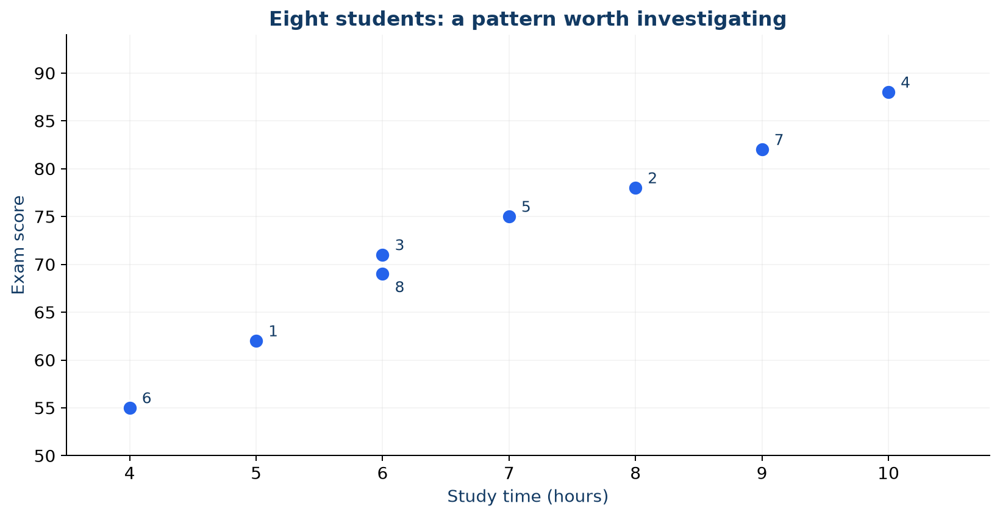
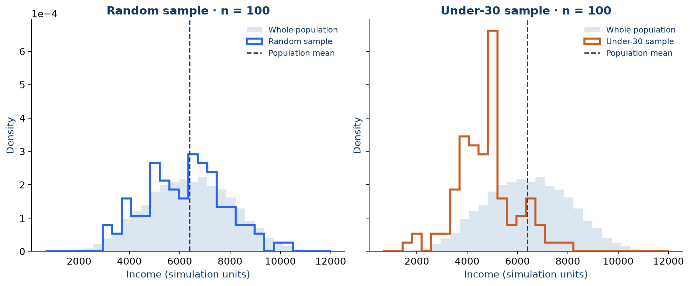
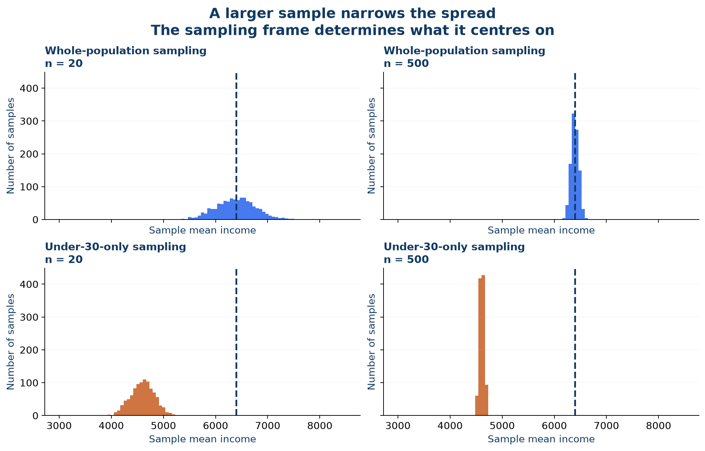
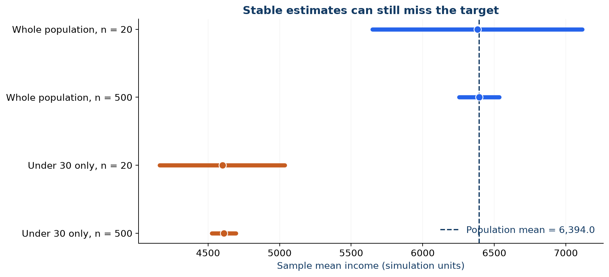

# Can we trust this study?

A university announces that its students study **6.875 hours** and achieve an average exam score of **72.5**. The numbers look precise. But they come from just eight records. Before deciding whether the announcement is useful, we need to know who those students are, how they entered the dataset and which students the announcement is supposed to describe.

This chapter brings together the first lecture workbook, **Lab 1: From Data to Statistical Thinking**, and **Seminar 1: Can We Trust This Study?** Chapter 1 introduced the [language of data](01_1_language_of_data.md) and [study design](01_2_types_of_studies.md). Here we use that vocabulary to investigate claims, run a sampling experiment and defend a conclusion. The emphasis is on reasoning before calculation.

By the end, you should be able to distinguish an observed result from a population claim, explain why sample means vary, identify problems that a larger sample cannot fix, and write a conclusion that respects the study design.

**How to work through the chapter.** Make a prediction before each calculation. Compare your reasoning with a partner before reading the answer. Run the Python blocks in order in a fresh notebook; they use NumPy, pandas and Matplotlib and need no downloaded dataset. The eight-student table is the classroom example from Lab 1. The income population is artificial, and its units are deliberately unspecified.

## 2.1 Eight students and one tempting claim

In Lab 1, each row represents one student and each column describes a characteristic of that student.

```python
import numpy as np
import pandas as pd
import matplotlib.pyplot as plt

students = pd.DataFrame({
    "age": [19, 20, 21, 22, 20, 24, 19, 21],
    "study_hours": [5, 8, 6, 10, 7, 4, 9, 6],
    "exam_score": [62, 78, 71, 88, 75, 55, 82, 69],
    "program": ["M", "M", "E", "M", "E", "E", "M", "E"],
    "passed": [True, True, True, True, True, False, True, True],
})
print(students.shape)
print(students.dtypes)
print(students.describe())
print(students["program"].value_counts())
```

The table has **eight observations and five variables**. Mean study time is 6.875 hours and mean exam score is 72.5. Programmes M and E each appear four times, so there is no unique most frequent programme. Seven of the eight students passed.

`passed` is a categorical variable with two possible outcomes. Coding these outcomes as 1 and 0 makes their mean a useful proportion, but does not turn passing into a continuous measurement. Similarly, recording age in whole years does not make all numerical-looking columns interchangeable. Statistical meaning comes from what the variable represents.

**Pause and decide.** Which statement needs information that is not in the table?

1. Seven of these eight students passed.
2. The pass rate among all students at the university is 87.5%.
3. In these eight records, higher study time tends to accompany higher exam scores.
4. Making a student study for one more hour will improve their exam score.

Statements 1 and 3 describe the observed data. Statement 2 extends a sample result to a population. Statement 4 makes a causal claim about an intervention. Neither 2 nor 4 follows from the table alone. A claim can be inferential or causal in its **intent** and still lack adequate evidence.



*Figure 2.1. Each point is one of the eight students. The pattern raises a research question; it does not identify the effect of an extra hour of study.*

The graph adds something that the mean cannot: it shows how two variables move together. Prior knowledge, motivation and course difficulty might help explain the pattern. The table does not record those variables or explain how students were selected. Neither `describe()` nor an attractive plot can recover that missing design information.

**Try it.** Calculate the pass proportion with `students["passed"].mean()`. Write one sentence reporting it without claiming anything about students outside the table.

## 2.2 Follow the people before following the numbers

The lecture workbook asks us to investigate a city transport survey. The office wants the mean one-way commuting time of **all adult residents**. It selects **800 addresses** and receives **360 responses**.

These numbers describe different stages of the study. An address is a sampling unit, whereas an adult resident is the intended observational unit. The study must specify how an adult is selected within each household. Otherwise adults in different household sizes may have different chances of inclusion.

| Stage | What we need to establish |
| --- | --- |
| Target population | Which adult residents, in which city and time period? |
| Sampling frame | Does the address register cover the target population? |
| Selected sample | How were the 800 addresses selected and adults chosen within them? |
| Responding sample | Who supplied the 360 responses, and is there one response per address? |
| Measurement | What counts as a commute, and how is its duration recorded? |
| Conclusion | Are we describing respondents or estimating a mean for all adults? |

If there is one eligible response per selected address, 360/800 gives an address-level response fraction of **45%**. It is not automatically the response rate of a probability sample of adults. We still need the within-household selection rule and information about eligibility.

There is another definition to settle: some adults do not commute. Is their time zero, is the question inapplicable, or should the target population be adult commuters? These choices define different population quantities. A calculation cannot decide which question the office meant to ask.

**Your verdict.** Complete the statement without inventing a mean:

> Among the 360 respondents, the observed mean commuting time was ____. Using it to estimate the mean for ____ requires information about ____.

A useful completion names the target population and the selection, response and measurement processes. “We need more data” is too vague: identify which missing information could change your judgment.

### A census also needs a boundary

Inspecting every product made during one shift is a census of that shift's output. It is not a census of all future production. Even complete coverage of a defined population does not eliminate recording errors, and it does not automatically justify conclusions about other populations or periods.

## 2.3 Build a world where the truth is known

Real studies rarely let us check an estimate against a known population mean. A simulation does. Lab 1 creates 10,000 people whose incomes tend to increase with age. Reproduce that population exactly:

```python
rng = np.random.default_rng(42)
age = rng.integers(18, 70, 10_000)
income = 2500 + age * 90 + rng.normal(0, 1000, 10_000)
population = pd.DataFrame({"age": age, "income": income})

population_mean = population["income"].mean()
print(f"Population mean: {population_mean:.2f}")
for seed in range(5):
    sample = population.sample(n=20, random_state=seed)
    print(f"Sample {seed}: {sample['income'].mean():.2f}")
```

The upper age limit in `integers` is excluded, so generated ages run from 18 through 69. The age–income relationship is a feature we built into this teaching model, not an empirical claim about a country or university. The random seed makes the example reproducible; it does not make the model realistic or the resulting sample representative of real people.

Let $N$ denote the population size and $n$ the sample size. The population mean is a **parameter**; a sample mean is a **statistic**:

$$
\mu = \frac{1}{N}\sum_{i=1}^{N} y_i,
\qquad
\bar{x} = \frac{1}{n}\sum_{j=1}^{n} x_j.
$$

Once the artificial population has been generated, its mean is fixed. The sample mean changes when we draw a new sample. The five printed means therefore need not agree with one another or with the population mean. This is **sampling variability**. A discrepancy in one random sample does not by itself demonstrate bias.

In this chapter, random sampling means **simple random sampling without replacement**: every subset of size $n$ from the sampling frame has the same probability of selection. Other probability sampling designs exist; not all give every possible subset the same probability.

### Why one sample at each size can mislead

Lab 1 compares samples of sizes 10, 20, 100, 500 and 2,000. That is a good first experiment, but a particular larger sample can still be farther from the population mean than a particular smaller sample. “More stable” is a statement about how the procedure behaves **over repeated samples**.

To see stability, repeat the sampling procedure many times. Each repetition produces one estimate. A histogram of those estimates approximates the **sampling distribution of the sample mean**. Its horizontal axis contains means, not individual incomes.

## 2.4 The huge-sample trap

Now compare two sampling frames. The first includes all 10,000 people. The second includes only people younger than 30, even though the target remains the whole population.

```python
random_sample = population.sample(n=100, random_state=42)
young_population = population.loc[population["age"] < 30]
young_only_sample = young_population.sample(n=100, random_state=42)

comparison = pd.DataFrame({
    "group": ["Population", "Random sample", "Under-30 sample"],
    "mean_age": [population["age"].mean(),
                 random_sample["age"].mean(),
                 young_only_sample["age"].mean()],
    "mean_income": [population_mean,
                    random_sample["income"].mean(),
                    young_only_sample["income"].mean()],
})
print(comparison.round(2))
```

**Predict first.** Which income distribution should be shifted to the left? Use the population-generating rule to explain your answer.



*Figure 2.2. Both samples contain 100 people. Density scaling makes their distribution shapes comparable with the 10,000-person population. The dashed line marks the whole-population mean.*

Raw frequency histograms would mainly reflect the difference in group sizes. Using `density=True` normalises each histogram to total area one. Bar heights are densities, not individual probabilities; an interval's probability is represented by area.

The second procedure selects people randomly **within the wrong frame for the stated target**. People aged 30 and above cannot enter it. Since age and income are related in this model, its mean income systematically targets a younger population's mean. A sample can therefore be randomly drawn and still be unsuitable for the intended inference.

### Repeat the investigation one thousand times

```python
sim_rng = np.random.default_rng(2026)
frames = {
    "Whole population": population["income"].to_numpy(),
    "Under 30 only": young_population["income"].to_numpy(),
}
results = {}
for frame_name, values in frames.items():
    for n in [20, 500]:
        results[(frame_name, n)] = np.array([
            sim_rng.choice(values, size=n, replace=False).mean()
            for _ in range(1000)
        ])

fig, axes = plt.subplots(2, 2, figsize=(11, 7), sharex=True, sharey=True)
bins = np.linspace(3000, 8500, 90)
for ax, ((frame_name, n), estimates) in zip(axes.flat, results.items()):
    ax.hist(estimates, bins=bins)
    ax.axvline(population_mean, color="black", linestyle="--")
    ax.set(title=f"{frame_name}, n={n}",
           xlabel="Sample mean income", ylabel="Number of samples")
fig.tight_layout()
plt.show()
```

Sampling is without replacement **within** each repetition. The full frame is available again for the next repetition, so a person can appear in different samples. We keep one fixed population throughout: the experiment isolates the effect of sampling instead of creating a different population every time.



*Figure 2.3. Each histogram summarises 1,000 estimates from the same procedure. The shared axes allow a direct comparison. The dashed line is the target population mean.*

Read the figure in two directions. Moving across a row increases sample size and reduces spread. Moving down a column changes the sampling frame and shifts the centre. Increasing $n$ addresses the first problem; it does not correct the second.



*Figure 2.4. Dots mark the average estimate across repetitions. Lines span the empirical 2.5th to 97.5th percentiles of those estimates. They describe simulated sampling variability; they are not confidence intervals computed from one observed sample.*

**Precision** describes how closely repeated estimates cluster. **Bias** is the difference between the estimator's expected value under the sampling procedure and the target parameter. In this example, repeated under-30 samples estimate the under-30 mean, so the bias for the whole-population mean is the difference between those two population means.

**Challenge.** Change the target to “mean income among people under 30.” Is the under-30 procedure still biased for that target? Explain before changing any code. Then investigate $n=100$ and $n=1000$ using the same target and repeated-sampling approach.

## 2.5 The bias courtroom

The seminar asks each group to act as a statistical jury. A verdict needs a mechanism: say **who is missing**, **what is distorted**, or **why ordinary random variation could explain the discrepancy**.

| Evidence | Main concern | An improvement that addresses it |
| --- | --- | --- |
| Study time is measured among 120 students leaving the library at 9 p.m. | Selection may favour students with particular study habits. | Sample from the student register across the intended population. |
| A questionnaire goes to 10,000 students and 800 reply. | Nonresponse may matter if respondents differ on the outcome of interest. | Follow up selected nonrespondents and investigate response patterns. |
| A fitness app includes only users who enabled workout tracking. | Coverage depends on behaviour related to exercise. | Define the target and include a way to reach nontracking users. |
| A question asks whether “responsible students” should attend every lecture. | Leading wording can influence the recorded answer. | Use neutral wording and pilot the question. |
| A device consistently records values too high. | Systematic measurement error shifts the measurements. | Calibrate the device before collecting further measurements. |
| A simple random sample of 40 has a mean different from the population mean. | Sampling variability is an expected explanation. | Quantify uncertainty; do not diagnose bias from the difference alone. |

A low response fraction is a warning, not proof of nonresponse bias. Bias depends on how responding is related to the quantity being estimated. Likewise, measurement error need not always be systematic: a single typo and a consistently miscalibrated device are different mechanisms.

### Jury challenge

Study A has **120,000 voluntary responses** to an open online poll. Study B has **1,000 respondents selected through a probability sampling design**. Which deserves more confidence for a population estimate?

A defensible answer starts by defining the population and checking coverage, response and measurement in both studies. Study B has a stronger starting point for design-based inference because selection probabilities are known, but that alone does not guarantee a good final estimate. Study A's size does not reveal who could or would participate.

**Discuss in pairs.** One person argues for A using only sample size. The other identifies a plausible selection mechanism that could invalidate that argument. Switch roles and identify a weakness that B could still have.

## 2.6 Coffee and grades need a study design

The seminar's question, “Does coffee improve exam performance?”, asks about an effect. An observational study could record coffee consumption and scores. But students choose their own coffee consumption, and that choice may be related to sleep, stress or study time.

A plausible confounder is related to the exposure and influences the outcome; merely listing a variable that predicts scores does not establish confounding. For example, sleep habits might affect both coffee consumption and performance. The observed coffee–score association could then partly reflect differences in sleep.

A proposed randomized experiment would assign a specified treatment and comparison condition and measure an outcome consistently. Random assignment balances pre-treatment characteristics **in expectation**, not perfectly in every finite sample. Adherence, missing outcomes and measurement still matter. The caffeine example is a study-design exercise, not an instruction to administer a substance.

| Design feature | Question it helps answer |
| --- | --- |
| Random sampling from an appropriate frame | Can sample evidence support inference about the target population? |
| Random assignment to treatment | Can outcome differences support a causal interpretation within the study? |
| Consistent, appropriate measurement | Did we measure the outcome we actually meant to study? |

Lab 1 uses a **reaction-time task**, whereas the seminar asks about **exam performance**. These are different outcomes. Even a convincing causal result for reaction time does not by itself establish an effect on grades.

**Write the conclusion.** For each design, finish “The study could support …, provided …”. In the observational version, report an association and acknowledge possible confounding. In the randomized version, specify the assigned treatment, measured outcome and study participants. Do not silently extend the result to every student or every kind of performance.

## 2.7 How much uncertainty belongs beside an estimate

The workbook gives a preference estimate of **56% ±5%**. When discussing a proportion, this should be stated as **56% ±5 percentage points**, corresponding to 51%–61%. A relative change of 5% would mean something different.

That notation alone is incomplete. We need to know the target population, sampling method, calculation method and, if this is a confidence interval, its confidence level. We cannot infer “95% confidence” just from the plus–minus sign. A conventional sampling margin also does not automatically cover selection bias, nonresponse bias or measurement error.

Later chapters will show how to construct intervals. For now, distinguish the observed value, the population quantity it estimates and the uncertainty attached to the procedure. A precise interval around an estimate from an unsuitable frame can still miss the intended target systematically.

### A prediction also affects people

The seminar asks whether a university should use learning-platform activity to predict failure. A login count measures recorded platform access, not learning itself. A student may work offline, share a device or have accessibility constraints. A prediction can be statistically accurate on average while causing harm when used carelessly for individuals.

Before proposing an intervention, identify the measured outcome, consider which students the data underrepresent, and discuss the consequences of a false alarm and a missed case. Explain what students would be told and how they could correct inaccurate records. These questions connect data quality to the decisions made with the data.

## 2.8 Your final study review

Return to the opening announcement and replace it with a conclusion you could defend. Use this five-question review for the workbook, lab and seminar:

1. **Population:** Exactly whom, where and when does the question concern?
2. **Sample:** Which units actually supplied the observations?
3. **Selection:** How could units enter the sample, and who did not respond?
4. **Measurement:** What do the recorded variables measure, and what might distort them?
5. **Conclusion:** Does the design support description, population inference or a causal claim, and how is uncertainty reported?

A defensible report on the opening data is: “Among these eight student records, mean study time was 6.875 hours and mean exam score was 72.5. The sample-selection process is unspecified, so these summaries alone do not establish university-wide averages.”

### Exit ticket

Answer each question before checking the notes below.

1. Why can a random sample mean differ from the population mean without being evidence of bias?
2. Why can 500 people selected only from the under-30 group be worse for the whole-population target than 20 people sampled from everyone?
3. When would the under-30 frame be appropriate?
4. Does an 8% response fraction prove nonresponse bias?
5. What does random assignment add to the coffee study, and what does it leave unresolved?
6. What information is missing from “56% ±5 percentage points”?

### Check your reasoning

**1.** Random selection changes the observations entering the mean. Unbiasedness concerns the mean over all possible samples under the procedure, not exact agreement in every sample.

**2.** The restricted frame excludes a group whose incomes differ in this model. A larger sample concentrates estimates around the wrong population mean. This compares procedures; a particular small random sample can still be inaccurate.

**3.** When the target is people under 30 in that artificial population, assuming simple random selection within the complete frame and correct measurements.

**4.** No. It raises concern. The key question is whether the response process changes the estimate relative to the intended population quantity.

**5.** It supports causal comparison by breaking systematic links between treatment assignment and pre-treatment characteristics. It does not guarantee adherence, complete outcomes, good measurement or generalisation beyond the participants.

**6.** The population, design, interval method and intended confidence level, along with what sources of uncertainty the margin includes.

## Connections to your class materials

| Material | Use it alongside this chapter |
| --- | --- |
| Lecture 1 workbook, tasks 1–3 and sections 9–12 | Classify claims, reconstruct the transport survey and explain reliability. |
| Lab 1, sections 1–4 and optional challenge | Inspect the eight-student dataset, simulate a population and compare sampling frames. |
| Seminar 1, population detective, bias courtroom and coffee challenge | Defend a verdict, diagnose the mechanism and match conclusions to designs. |

The exercises and original scenarios above draw on **Lecture_1_WORKBOOK.docx**, **Lab_01.ipynb** and **Seminar_01_Can_We_Trust_This_Study.pptx** supplied for Week 1. The repeated-sampling investigation extends Lab 1. All four figures can be regenerated from the repository root with `python scripts/chapter02_figures.py`.

The next step is to describe sampling variability mathematically using probability models. Keep the distinction visible: a model quantifies uncertainty under assumptions; the study design determines whether those assumptions are useful for the question being asked.
