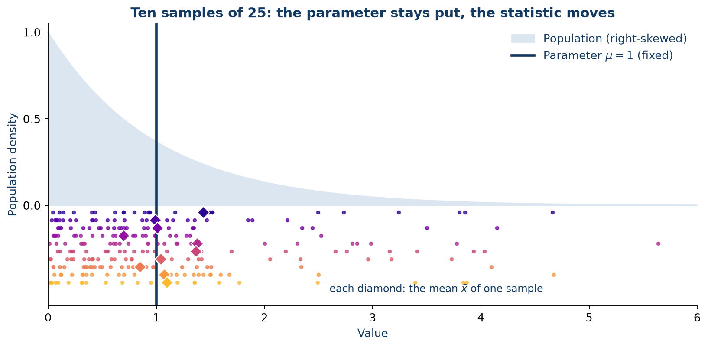
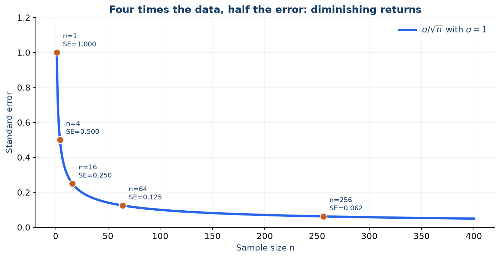
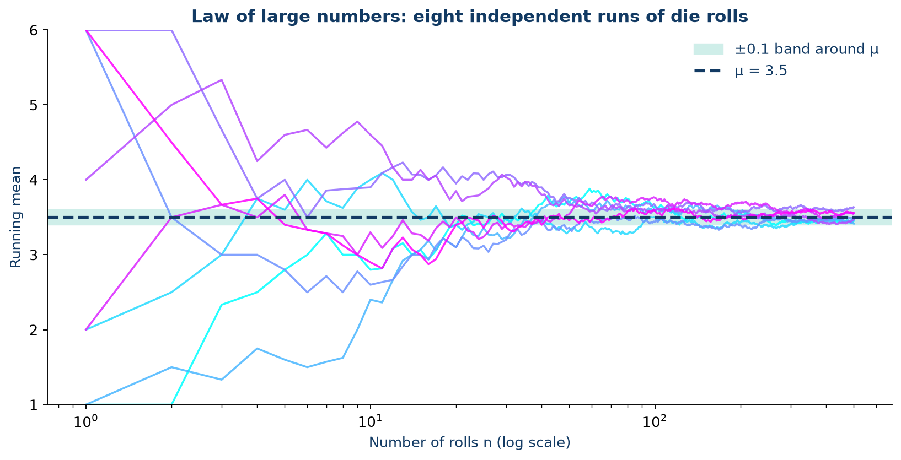
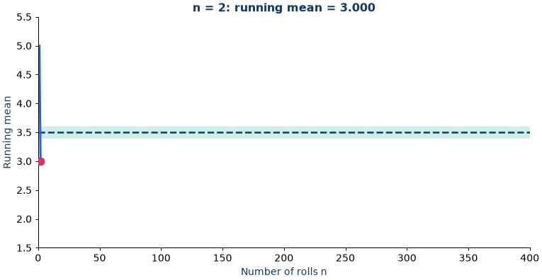
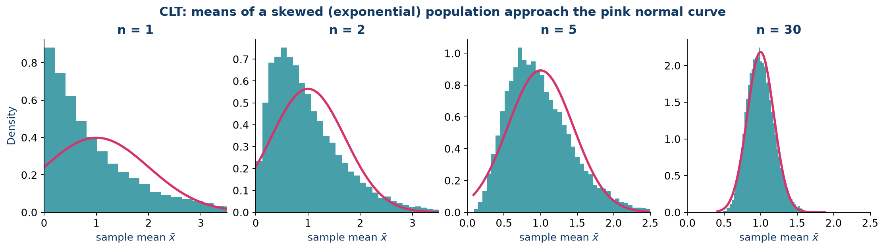
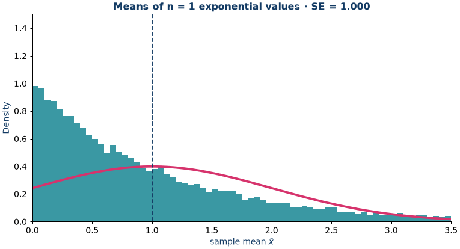
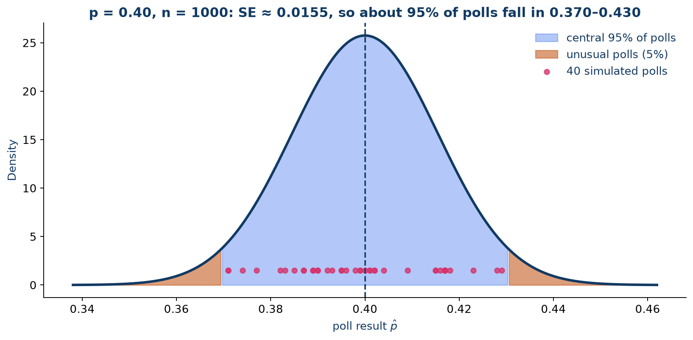
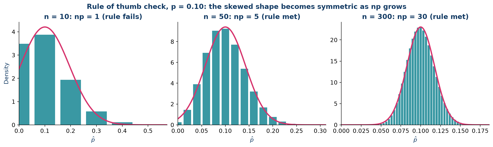
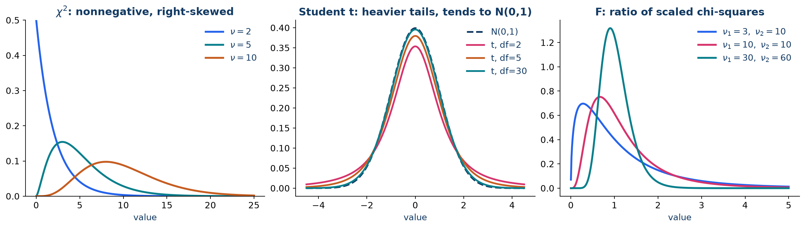
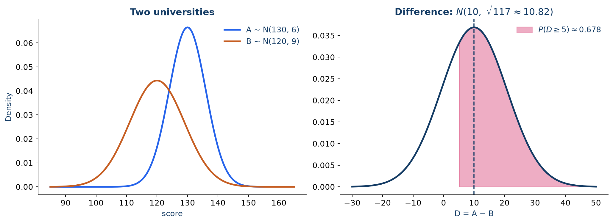

# Sampling, the law of large numbers, and the central limit theorem

One population can produce many different samples. Each sample has its own mean, proportion, and variance; these statistics change from sample to sample even when the population stays the same. Sampling theory describes that variation and explains why averages often become predictable.

  
The central idea

  
A parameter belongs to a population or model and is fixed. A statistic is calculated from a random sample and therefore varies. The law of large numbers describes where averages go; the central limit theorem describes how their variation is shaped.

By the end of this chapter, you should be able to distinguish parameters from statistics, derive the mean and standard error of a sample mean, explain the law of large numbers and the central limit theorem, work with sample proportions, and recognise when the $t$, $\chi^2$, and $F$ distributions arise.

## 4.1 A statistic has a sampling distribution

Let $X_1,\ldots,X_n$ be a random sample from a population with mean $\mu$ and variance $\sigma^2$. The population quantities $\mu$ and $\sigma^2$ are **parameters**. The sample mean

$$
\bar X = \frac{1}{n}\sum_{i=1}^n X_i
$$

is a **statistic**: before sampling it is random, and after observing the sample it has a particular value.

The probability distribution of a statistic over repeated samples of the same size is its **sampling distribution**. It is not the distribution of individual observations. For example, even when individual incomes are strongly right-skewed, the distribution of means from repeated samples of 100 incomes may be much more symmetric.

*Each coloured row is one sample. The vertical line (the parameter) never moves; the diamonds (the statistic) do.*

If the observations are independent and have the same mean and variance, linearity of expectation gives

$$
E(\bar X)
= \frac{1}{n}\sum_{i=1}^n E(X_i)
= \mu.
$$

Thus $\bar X$ is an unbiased estimator of $\mu$. Independence gives

$$
\operatorname{Var}(\bar X)
= \frac{1}{n^2}\sum_{i=1}^n\operatorname{Var}(X_i)
= \frac{\sigma^2}{n},
\qquad
\operatorname{SE}(\bar X)=\frac{\sigma}{\sqrt n}.
$$

The **standard error (SE)** is the standard deviation of the sampling distribution. It measures how much a statistic typically varies from sample to sample; it is not the standard deviation of the individual observations.

| Change in sample size | Standard error of the mean |
| --- | --- |
| Multiply $n$ by 4 | Divide the SE by 2 |
| Multiply $n$ by 9 | Divide the SE by 3 |
| Multiply $n$ by 100 | Divide the SE by 10 |

Precision improves at the rate $1/\sqrt n$, not $1/n$. Making a sample four times larger halves the standard error, all else equal.

## 4.2 The law of large numbers

The **weak law of large numbers (WLLN)** says that for independent, identically distributed observations with finite mean and variance, the sample mean converges in probability to the population mean:

$$
\bar X_n \xrightarrow{P} \mu.
$$

In explicit terms, for every $\varepsilon>0$,

$$
\lim_{n\to\infty}
P\!\left(\left|\bar X_n-\mu\right|\geq\varepsilon\right)=0.
$$

As the sample grows, it becomes increasingly unlikely that the sample mean will be far from the population mean. This is a long-run statement, not a promise that every successive observation moves the running average closer to $\mu$, nor a claim that a finite sample must be accurate.

### Proof using Chebyshev's inequality

For an iid sample with finite variance $\sigma^2$, the variance calculation above gives $\operatorname{Var}(\bar X_n)=\sigma^2/n$. Chebyshev's inequality states that any random variable $Y$ with finite variance satisfies

$$
P\!\left(|Y-E(Y)|\geq\varepsilon\right)
\leq \frac{\operatorname{Var}(Y)}{\varepsilon^2}.
$$

Apply this inequality to $Y=\bar X_n$. Since $E(\bar X_n)=\mu$,

$$
P\!\left(|\bar X_n-\mu|\geq\varepsilon\right)
\leq \frac{\sigma^2}{n\varepsilon^2}
\longrightarrow 0
\quad\text{as } n\to\infty.
$$

This proves the WLLN under the stated assumptions. The bound also shows why larger samples help, while leaving nonzero uncertainty at every finite $n$.

### Example: repeated rolls of a fair die

For one fair six-sided die roll $X$, symmetry gives

$$
E(X)=\frac{1+2+3+4+5+6}{6}=3.5,
\qquad
\operatorname{Var}(X)=\frac{35}{12}.
$$

The average of many independent rolls tends to 3.5 in probability. A short run can still have a noticeably different average.

*Early on the paths disagree wildly; by a few hundred rolls they are squeezed around $\mu=3.5$. Note the logarithmic horizontal axis.*

:::{tip} Try it yourself
Watch the animation and note when the running mean enters the $\pm0.1$ band for good. Then compare with the eight paths above: is that moment the same for every path?
:::

The interactive [dice-sampling app](04_1_dice_sampling.md) lets you compare the observed distribution of two-dice sums with its exact probabilities and simulate means of repeated rolls.

## 4.3 The central limit theorem

The **central limit theorem (CLT)** describes the shape of the sampling distribution. If $X_1,\ldots,X_n$ are iid with mean $\mu$ and finite, nonzero variance $\sigma^2$, then

$$
\frac{\bar X_n-\mu}{\sigma/\sqrt n}
=\frac{\sum_{i=1}^n(X_i-\mu)}{\sigma\sqrt n}
\xrightarrow{d}N(0,1).
$$

Here $\xrightarrow{d}$ denotes convergence in distribution. For large $n$, the sample mean is therefore approximately normal:

$$
\bar X_n \ \dot\sim\ N\!\left(\mu,\frac{\sigma^2}{n}\right).
$$

The approximation concerns the **sampling distribution of the mean**, not necessarily the distribution of individual observations. The CLT does not say that the population becomes normal, and it does not make a biased or dependent sample representative.

:::{tip} What to look for
Each frame draws 15,000 sample means. Notice two things at once: the **shape** moves from skewed to symmetric, and the **width** shrinks like $1/\sqrt n$. Compare $n=4$ with $n=16$ in the standard-error plot above: how much narrower should the curve be?
:::

### Proof sketch using characteristic functions

Standardise one observation as $Y_i=(X_i-\mu)/\sigma$. Then $E(Y_i)=0$ and $\operatorname{Var}(Y_i)=1$. For a variable with finite variance, its characteristic function has the expansion near zero

$$
\varphi_Y(t)=E(e^{itY})=1-\frac{t^2}{2}+o(t^2).
$$

Independence means that the characteristic function of the standardised sum is the product of the individual characteristic functions:

$$
\varphi_{\frac{1}{\sqrt n}\sum_{i=1}^n Y_i}(t)
=\left[\varphi_Y\!\left(\frac{t}{\sqrt n}\right)\right]^n
=\left[1-\frac{t^2}{2n}+o\!\left(\frac{1}{n}\right)\right]^n
\longrightarrow e^{-t^2/2}.
$$

The limit $e^{-t^2/2}$ is the characteristic function of a standard normal random variable. The continuity theorem for characteristic functions then gives the CLT. This is a proof sketch: it shows the central mechanism, while the characteristic-function expansion and continuity theorem provide the formal steps.

The CLT is an asymptotic result. How large $n$ must be for a useful approximation depends on the population's shape, skewness, tail behaviour, and the probability being estimated. A highly skewed distribution or rare extreme values may require a much larger sample than a nearly symmetric one.

## 4.4 Sample proportions and polling

For independent Bernoulli observations $X_i\in\{0,1\}$ with success probability $p$, the sample proportion is

$$
\hat p=\frac{1}{n}\sum_{i=1}^n X_i.
$$

Since $E(X_i)=p$ and $\operatorname{Var}(X_i)=p(1-p)$,

$$
E(\hat p)=p,
\qquad
\operatorname{Var}(\hat p)=\frac{p(1-p)}{n},
\qquad
\operatorname{SE}(\hat p)=\sqrt{\frac{p(1-p)}{n}}.
$$

The CLT gives an approximate normal sampling distribution when there are enough expected successes and failures. A common introductory rule of thumb is

$$
np\geq 5
\quad\text{and}\quad
n(1-p)\geq 5,
$$

although stricter cut-offs are often used for more accurate tail approximations.

**Example: repeated polls.** Suppose the true support for a candidate is $p=0.40$ and each poll samples $n=1000$ people independently. Then

$$
\operatorname{SE}(\hat p)
=\sqrt{\frac{0.4(0.6)}{1000}}
\approx 0.0155.
$$

An approximate 95% range for the result of a single poll, under this model, is

$$
0.40\pm1.96(0.0155)
\approx (0.370,\,0.430).
$$

The range describes sampling variation, not all sources of polling error. Coverage problems, nonresponse, question wording, and dependence between respondents are not fixed merely by increasing $n$.

*Forty simulated polls from the same population: nearly all land in the blue region, and a couple fall in the tails, just as the model predicts.*

For a proportion near 0 or 1, a sample size of 10 may not give a symmetric sampling distribution. The normal approximation improves as the expected numbers of successes and failures grow, but checking the approximation is more informative than applying a sample-size rule mechanically.

## 4.5 The $\chi^2$, $t$, and $F$ distributions

Three important families of sampling distributions arise when normal data are used to reason about variability.

*Left: $\chi^2$ is nonnegative and right-skewed. Centre: $t$ has heavier tails than $N(0,1)$ and approaches it as degrees of freedom grow. Right: $F$ is nonnegative and right-skewed, with its shape set by both degrees of freedom.*

### The chi-square distribution

If $Z_1,\ldots,Z_\nu$ are independent standard normal variables, then the sum of their squares has a chi-square distribution with $\nu$ degrees of freedom:

$$
Q=\sum_{i=1}^{\nu} Z_i^2\sim\chi^2_\nu.
$$

Each squared standard normal has mean 1 and variance 2. Independence therefore gives

$$
E(Q)=\nu,
\qquad
\operatorname{Var}(Q)=2\nu.
$$

The distribution is nonnegative and generally right-skewed, especially for small $\nu$. With an iid sample from a normal population, the sample variance

$$
S^2=\frac{1}{n-1}\sum_{i=1}^n(X_i-\bar X)^2
$$

satisfies

$$
\frac{(n-1)S^2}{\sigma^2}\sim\chi^2_{n-1}.
$$

This result is used to build confidence intervals for a normal population variance and in chi-square goodness-of-fit methods. Its exact sampling result depends on normality.

### Student's $t$ distribution

If $Z\sim N(0,1)$ and independently $Q\sim\chi^2_\nu$, then

$$
T=\frac{Z}{\sqrt{Q/\nu}}\sim t_\nu.
$$

For a normal population with unknown standard deviation, replacing $\sigma$ by the sample standard deviation $S$ gives

$$
\frac{\bar X-\mu}{S/\sqrt n}\sim t_{n-1}.
$$

The $t$ distribution is symmetric about zero and has heavier tails than the standard normal for finite degrees of freedom. Estimating $\sigma$ adds uncertainty; as the degrees of freedom increase, the $t$ distribution approaches $N(0,1)$.

**Example: a confidence interval.** A sample of $n=16$ measurements from a normal population has $\bar x=12.4$ and $s=2.0$. Since $\sigma$ is unknown, a 95% interval for $\mu$ is

$$
\bar x\pm t_{0.975,15}\frac{s}{\sqrt n}
=12.4\pm2.131\left(\frac{2.0}{4}\right)
\approx (11.33,\,13.47).
$$

### The $F$ distribution

Let $Q_1\sim\chi^2_{\nu_1}$ and $Q_2\sim\chi^2_{\nu_2}$ be independent. Then

$$
F=\frac{Q_1/\nu_1}{Q_2/\nu_2}\sim F_{\nu_1,\nu_2}.
$$

The $F$ distribution is nonnegative and usually right-skewed. If two independent samples come from normal populations, a ratio of their sample variances, appropriately scaled, has an $F$ distribution under the equal-variance model. The family also appears in analysis of variance (ANOVA) and regression tests.

Variance-ratio tests are sensitive to departures from normality, and the numerator and denominator degrees of freedom have different roles. Always identify which sample variance is in the numerator before reading a critical value or computing a tail probability.

## 4.6 Differences between independent sample means

If $A$ and $B$ are independent random variables with finite variances, then

$$
E(A-B)=E(A)-E(B),
\qquad
\operatorname{Var}(A-B)=\operatorname{Var}(A)+\operatorname{Var}(B).
$$

The variances **add** because $\operatorname{Cov}(A,B)=0$; subtracting the variables does not subtract their uncertainty. If the variables are normally distributed, their difference is normal. For sufficiently large independent samples, the CLT can justify an approximate normal distribution for a difference of sample means even when the individual populations are not normal.

**Example: comparing two university scores.** Suppose scores at university A have mean 130 and standard deviation 6, while scores at university B have mean 120 and standard deviation 9. For independent scores $A$ and $B$,

$$
D=A-B,\qquad E(D)=10,\qquad
\operatorname{SD}(D)=\sqrt{6^2+9^2}=\sqrt{117}\approx10.82.
$$

Under the normal model,

$$
P(D\geq5)
=1-\Phi\!\left(\frac{5-10}{\sqrt{117}}\right)
=\Phi\!\left(\frac{5}{\sqrt{117}}\right)
\approx0.678.
$$

The calculation assumes independent scores and the stated normal models. If the two scores are paired or otherwise dependent, the covariance must be included.

*The difference is wider than either score distribution because the variances add; the shaded area is $P(D\geq5)\approx0.678$.*

## 4.7 Worked example: a weekend's tips

A server earns tips with mean \$10.90 and standard deviation \$5.60 per customer. Assume 60 tips over a weekend are independent and follow the same distribution. Let $T$ be their total. Then

$$
E(T)=60(10.90)=\$654,
\qquad
\operatorname{SD}(T)=\sqrt{60}(5.60)\approx\$43.38.
$$

By the CLT, approximate $T$ by a normal distribution. The probability of earning at least \$750 is

$$
P(T\geq750)
\approx1-\Phi\!\left(\frac{750-654}{43.38}\right)
\approx0.013.
$$

The threshold for the best 5% of weekends is the 95th percentile:

$$
654+1.645(43.38)\approx\$725.
$$

These answers are approximations, not exact guarantees. They rely on independence, a stable mean and variance, and a sample size for which the normal approximation to the total is adequate. Strong dependence in customer traffic or a changing mix of customers could change the uncertainty.

## 4.8 Choosing the right result

| Question | Useful result | Key conditions |
| --- | --- | --- |
| How does the sample mean vary? | $\operatorname{SE}(\bar X)=\sigma/\sqrt n$ | Independent observations with common finite variance |
| Why does an average settle near its mean? | Law of large numbers | Random sampling and finite mean (finite variance suffices for the proof here) |
| Why is an average often approximately normal? | Central limit theorem | Independent, identically distributed observations with finite, nonzero variance; approximation quality depends on shape and $n$ |
| How does a sample proportion vary? | $\operatorname{SE}(\hat p)=\sqrt{p(1-p)/n}$ | Independent Bernoulli trials; normal approximation needs enough successes and failures |
| How do we infer a normal population mean when $\sigma$ is unknown? | Student's $t$ distribution | Independent sample from a normal population for the exact result |
| How does sample variance behave under normality? | Chi-square distribution | Independent sample from a normal population |
| How can two normal population variances be compared? | $F$ distribution | Independent normal samples under the variance model |

Before using any of these results, define the statistic, check the sampling design and assumptions, and state whether the conclusion is exact or approximate. A large sample can reduce random error, but it cannot by itself remove selection bias, measurement error, or dependence.

### Check your understanding

1. A sample size is multiplied by 16. By what factor does the standard error of the sample mean change?
2. A population is strongly right-skewed. Does the CLT say that individual observations become normal when the sample size reaches 30?
3. A poll has $p=0.1$ and $n=10$. Which expected-count conditions for a normal approximation fail?
4. Why does replacing $\sigma$ with $S$ lead to a $t$ distribution rather than a standard normal distribution?
5. Two independent sample means are subtracted. Why do their variances add?

## 4.9 Continue with an interactive demonstration

Use the [interactive dice-sampling demonstration](04_1_dice_sampling.md) to explore a sampling distribution, the law of large numbers, and the CLT by changing sample sizes and collecting outcomes.
